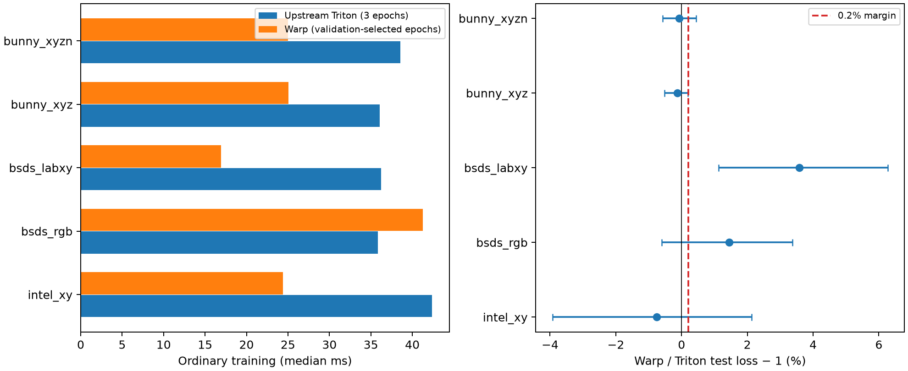

# Equal-loss runtime confirmation on real data

Warp epoch budgets were chosen on the validation split using seeds 0,1,2, before this test evaluation. The target was upstream Triton e-means at three epochs, with a predeclared 0.2% loss margin. The first passing budget among 1,2,3,5,10,25 was frozen. Test uses ten fresh paired initialization seeds (100–109), 16,384 test vectors, and FP64 squared-distance MSE. Backend order alternates. Each backend is warmed before measurement.

All timings are ordinary train calls with resident GPU inputs, including allocation and validation; input transfers, JIT warmup and loss evaluation are excluded. CUDA graph preparation/replay is not used. Both implementations compute in FP32 on the RTX PRO 6000 Blackwell MIG slice. Warp and Triton use different shuffle/revival random streams. GPU experiments launched by this session were stopped/completed before test timing, but the machine can be shared by other users.

The quality criterion is the upper endpoint of a paired 95% bootstrap interval for mean Warp test MSE / mean Triton test MSE being at most 1.002. Intervals resample ten seeds 10,000 times and describe initialization variation on these fixed datasets, not uncertainty across all applications. Every selected case is reported.

| Dataset | d | n | k | Warp epochs | Triton ms | Warp ms | Speedup | Test MSE ratio [95% interval] | Within 0.2% margin? |
|---|---:|---:|---:|---:|---:|---:|---:|---|---|
| intel_xy | 2 | 65,536 | 64 | 3 | 42.36 | 24.40 | 1.74× | 0.99247 [0.96077, 1.02135] | Inconclusive |
| bsds_rgb | 3 | 100,000 | 64 | 5 | 35.86 | 41.25 | 0.87× | 1.01449 [0.99391, 1.03377] | Inconclusive |
| bsds_labxy | 5 | 100,000 | 64 | 1 | 36.23 | 16.94 | 2.14× | 1.03587 [1.01130, 1.06272] | No |
| bunny_xyz | 3 | 100,000 | 256 | 3 | 36.06 | 25.05 | 1.44× | 0.99869 [0.99474, 1.00195] | Yes |
| bunny_xyzn | 6 | 100,000 | 256 | 3 | 38.56 | 25.01 | 1.54× | 0.99928 [0.99420, 1.00449] | Inconclusive |

Bunny XYZ meets the specified margin, narrowly: its interval upper endpoint is 1.00195. This is evidence for that fixed workload, not general equivalence. LabXY exceeds the margin; Intel XY, RGB and Bunny XYZ+normals remain inconclusive. Model/graph cleanup and garbage collection occur outside the timers; earlier exploratory timings affected by cleanup are excluded.

Raw evidence: [frozen validation choices](../../results/equal_loss_selection.json), [test runs](../../results/equal_loss_test.json), [summary](../../results/equal_loss_summary.json). [Dataset meanings and limitations](../datasets.md). The wider-dimensional performance gap remains [issue #6](https://github.com/alecjacobson/warp-emeans/issues/6).

Reproduce with `uv run python scripts/benchmark_equal_loss.py --phase select`, then `--phase test`, and `uv run python scripts/report_equal_loss.py`. Avoid concurrent GPU experiments for the test phase.
