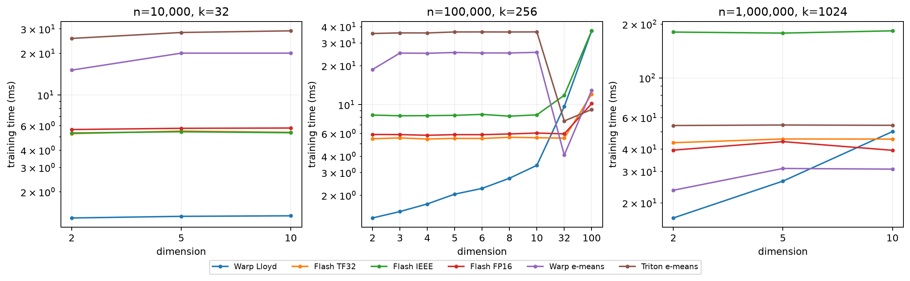

# Flash-KMeans GPU Lloyd baseline

This adds the missing external GPU Lloyd comparison to the [Warp baseline study](kmeans-baseline.md). It measures the unmodified [**Flash-KMeans 0.3.1**](https://pypi.org/project/flash-kmeans/0.3.1/) API used by the e-means paper, with shared initial centers and identical Lloyd iteration counts. It does not establish the fastest possible Triton implementation on every GPU.

Across the seven real feature datasets at the frozen Lloyd budgets, Warp takes less time and establishes the +0.2% loss margin against Flash IEEE on all seven, against Flash FP16 on six, and against Flash TF32 on two. These are per-dataset initialization results without a multiple-comparison adjustment; the datasets are not seven independent application domains.

On RGB (100,000 vectors, k=64, 100 Lloyd iterations), Warp takes **3.43 ms**, Flash IEEE **18.87 ms**, Flash TF32 **19.27 ms**, and Flash FP16 **20.78 ms**. The corresponding three-pass Warp/Triton e-means calls take **24.88/36.23 ms**. Quality comparisons and every other case follow below.

RGB meets the specified +0.2% loss margin against Flash IEEE and FP16. Against Flash TF32, Warp's mean loss is higher and the margin is not established. The new seeds also do not establish the earlier RGB quality advantage over either e-means implementation. The old ten-seed result remains archived; initialization variability on a fixed corpus limits how broadly either result can be interpreted.

In the fixed-budget synthetic matrix, Flash TF32/FP16 beat Warp Lloyd at n=100,000 with d=32/100, and at n=1,000,000 with d=10. Warp Lloyd leads on the remaining measured low-dimensional cases. IEEE Flash is slower than its lower-precision modes, particularly at n=1,000,000. Runtime crossovers and numerical differences both matter; none of these observations establish a universal best k-means implementation.

## Reference and numerical controls

[Appendix C](https://arxiv.org/html/2611.09501v1#A3) identifies Flash-KMeans 0.3.1. The [pinned upstream benchmark](https://github.com/facebookresearch/faiss/blob/c8f283867285af547db7a701c1b8dfa89631b3ea/benchs/e_means/paper_xb.py) calls `flash_kmeans.kmeans_triton_impl.batch_kmeans_Euclid` once, supplies initial centers, and uses `max_iters=T, tol=-1`. We use that call and assert the returned iteration count equals T, including on already-converged data. Flash and Warp both retain empty centers. The installed Flash sources are unmodified and SHA256-fingerprinted in each archive.

| Arm | Resident input / centers | Assignment arithmetic |
| --- | --- | --- |
| Warp Lloyd | FP32 | Direct squared differences in FP32; conservative pruning on eligible large cases |
| Flash TF32 | FP32 | Unmodified default: TF32 dot products, FP32 norms and updates |
| Flash IEEE | FP32 | `TRITON_F32_DEFAULT=ieee`: IEEE FP32 dot products, FP32 norms and updates |
| Flash FP16 | FP16 | Paper-style input and center rounding, FP16 products with FP32 accumulation/updates; means cast to FP16 each iteration |

All Flash modes form distances using norms and dot products and clamp negative distances to zero. The public FP16 call also stores point norms in FP16. Even IEEE Flash and direct-distance Warp can diverge on close ties and follow different Lloyd trajectories. IEEE means product precision, not bitwise agreement or an exact-real-arithmetic oracle. FP16 receives rounded copies of the shared FP32 data/centers, so it is a separate precision tradeoff. Quality is always evaluated on the original unrounded held-out vectors in FP64.

The compiled Triton IR is checked for the requested FP32 product precision and archived with IR/PTX hashes. Fresh processes separate TF32 and IEEE to prevent reuse of an in-memory specialization with another precision setting. Explicit `TRITON_DEFAULT_FP_FUSION=1` preserves the installed Triton default. No patches for norm overflow or manual feature padding were needed for this corpus.

Hardware: NVIDIA RTX PRO 6000 Blackwell Server Edition MIG 2g.48gb, 94 SMs. Warp 1.19.0, Flash-KMeans 0.3.1, PyTorch 2.15.0+cu132, Triton 3.9.0. Flash 0.3.1 does not recognize this GPU in its named architecture tuning tables and selects its conservative split-D fallback. We retain the API's default `use_heuristic=True`, as the pinned paper call does. These results therefore measure that public implementation on this machine; they are not a reproduction of the paper's H100/low-precision e-means comparison or a kernel-only comparison.

## Timing protocol

Ordinary training with resident inputs: one untimed full-call warmup, then three synchronized wall-time samples per seed; tables show the median across seed medians. Each configuration and FP32-dot mode uses a fresh process. TF32/FP16/Warp arms alternate order by seed; the IEEE worker follows immediately for the same configuration. Timers include allocation, center initialization from the supplied array, norm computation, all iterations, and Flash's Python loop/convergence synchronization even with `tol=-1`. They exclude input transfer/casting, compilation, cleanup and loss evaluation. No graph replay is mixed into this comparison. The container/GPU can be shared with other agents; samples characterize this run, not an uncontended-machine guarantee. Scaling uses one warmed sample per record for quality evaluation only.

## Fixed-budget matrix

Same 15 synthetic configurations and seven real feature datasets as the existing study; seeds 0–2. Lloyd uses 25 full-data iterations and e-means three passes. This table measures elapsed time at those budgets; it does not claim equal quality. Full mean losses and raw samples are archived.

| Dataset | n | d | k | Warp Lloyd ms | Flash TF32 ms | Flash IEEE ms | Flash FP16 ms | Warp e-means ms | Triton e-means ms |
| --- | --- | --- | --- | --- | --- | --- | --- | --- | --- |
| normal | 10,000 | 2 | 32 | 1.30 | 5.26 | 5.32 | 5.64 | 15.15 | 25.66 |
| normal | 10,000 | 5 | 32 | 1.33 | 5.50 | 5.44 | 5.76 | 20.09 | 28.31 |
| normal | 10,000 | 10 | 32 | 1.34 | 5.38 | 5.35 | 5.78 | 20.09 | 29.10 |
| normal | 100,000 | 2 | 256 | 1.34 | 5.46 | 8.32 | 5.90 | 18.71 | 35.47 |
| normal | 100,000 | 3 | 256 | 1.50 | 5.55 | 8.22 | 5.88 | 25.05 | 35.86 |
| normal | 100,000 | 4 | 256 | 1.72 | 5.44 | 8.24 | 5.81 | 24.96 | 35.82 |
| normal | 100,000 | 5 | 256 | 2.04 | 5.50 | 8.28 | 5.88 | 25.32 | 36.46 |
| normal | 100,000 | 6 | 256 | 2.26 | 5.49 | 8.43 | 5.87 | 25.11 | 36.48 |
| normal | 100,000 | 8 | 256 | 2.71 | 5.61 | 8.16 | 5.95 | 25.09 | 36.43 |
| normal | 100,000 | 10 | 256 | 3.41 | 5.57 | 8.36 | 6.05 | 25.38 | 36.49 |
| normal | 100,000 | 32 | 256 | 9.69 | 5.52 | 11.83 | 5.96 | 4.09 | 7.49 |
| normal | 100,000 | 100 | 256 | 37.15 | 12.11 | 37.19 | 10.21 | 12.92 | 9.19 |
| normal | 1,000,000 | 2 | 1024 | 16.49 | 43.47 | 180.74 | 39.51 | 23.56 | 54.24 |
| normal | 1,000,000 | 5 | 1024 | 26.50 | 45.61 | 178.37 | 44.07 | 31.19 | 54.59 |
| normal | 1,000,000 | 10 | 1024 | 50.17 | 45.55 | 183.62 | 39.41 | 30.93 | 54.38 |
| intel_xy | 65,536 | 2 | 64 | 1.33 | 5.39 | 5.61 | 5.71 | 24.09 | 42.31 |
| bsds_rgb | 100,000 | 3 | 64 | 1.34 | 5.48 | 5.46 | 6.01 | 24.96 | 36.11 |
| bsds_labxy | 100,000 | 5 | 64 | 1.35 | 5.48 | 5.35 | 5.89 | 25.14 | 36.07 |
| bunny_xyz | 100,000 | 3 | 256 | 1.51 | 5.55 | 8.24 | 5.91 | 25.20 | 35.90 |
| bunny_xyzn | 100,000 | 6 | 256 | 2.29 | 5.52 | 8.42 | 5.88 | 24.97 | 36.59 |
| drill_xyz | 100,000 | 3 | 128 | 1.33 | 5.39 | 6.25 | 5.85 | 25.04 | 36.34 |
| drill_xyzn | 100,000 | 6 | 128 | 1.66 | 5.56 | 6.22 | 6.02 | 24.90 | 36.95 |



## Frozen-budget real-data comparison

Reuse the previous validation-selected Lloyd budgets without tuning them for Flash. Cases with no validation match run the maximum attempted 200 iterations and remain labeled as failures. The no-match label refers to the original e-means validation target; same-budget comparisons between Lloyd implementations remain valid. All Lloyd arms receive the same budget; e-means keeps three passes. Ten new initialization seeds (300–309) use the same known 16,384 test vectors. These are new initialization replicates, not new scenes, new test data, or an independent validation of scaling laws.

| Dataset | Lloyd iterations | Warp Lloyd ms | Flash TF32 ms | Flash IEEE ms | Flash FP16 ms | Warp e-means ms | Triton e-means ms |
| --- | --- | --- | --- | --- | --- | --- | --- |
| intel_xy | 200 (no validation match) | 6.25 | 37.24 | 36.37 | 40.06 | 24.25 | 42.36 |
| bsds_rgb | 100 | 3.43 | 19.27 | 18.87 | 20.78 | 24.88 | 36.23 |
| bsds_labxy | 25 | 1.31 | 5.45 | 5.39 | 5.85 | 24.89 | 36.15 |
| bunny_xyz | 100 | 4.23 | 19.10 | 30.94 | 20.58 | 24.94 | 35.91 |
| bunny_xyzn | 50 | 3.99 | 10.13 | 16.15 | 10.94 | 24.83 | 36.27 |
| drill_xyz | 25 | 1.32 | 5.38 | 5.98 | 5.82 | 24.98 | 36.40 |
| drill_xyzn | 200 (no validation match) | 9.01 | 37.12 | 44.08 | 39.81 | 24.84 | 36.68 |

The next table is **Warp Lloyd loss relative to each comparator**, in percent, with a paired 95% bootstrap interval over ten initialization seeds (10,000 resamples). Negative means lower Warp loss. The predeclared noninferiority margin is +0.2%; the upper interval endpoint must be <=+0.2% to establish it. This is a one-sided quality criterion, not symmetric equivalence, and it is not adjusted for multiple comparisons. Intervals describe initialization variability on these fixed datasets only. Values displayed as 0.00% have magnitude below 0.005%; the summary retains full precision.

| Dataset | Comparator | Warp loss difference | 95% interval | +0.2% margin established? |
| --- | --- | --- | --- | --- |
| intel_xy | Flash TF32 | -0.51% | [-1.30%, +0.02%] | yes |
| intel_xy | Flash IEEE | -0.00% | [-0.00%, +0.00%] | yes |
| intel_xy | Flash FP16 | -0.03% | [-0.06%, +0.00%] | yes |
| intel_xy | Warp e-means | +8.99% | [-13.90%, +37.28%] | no validation match |
| intel_xy | Triton e-means | +13.51% | [+2.30%, +29.27%] | no validation match |
| bsds_rgb | Flash TF32 | +1.67% | [-0.13%, +3.60%] | not established |
| bsds_rgb | Flash IEEE | -0.03% | [-0.16%, +0.15%] | yes |
| bsds_rgb | Flash FP16 | -0.18% | [-0.55%, +0.08%] | yes |
| bsds_rgb | Warp e-means | -0.43% | [-1.78%, +1.12%] | not established |
| bsds_rgb | Triton e-means | +0.35% | [-2.04%, +2.29%] | not established |
| bsds_labxy | Flash TF32 | +0.23% | [-0.07%, +0.57%] | not established |
| bsds_labxy | Flash IEEE | -0.00% | [-0.01%, +0.01%] | yes |
| bsds_labxy | Flash FP16 | -0.02% | [-0.13%, +0.07%] | yes |
| bsds_labxy | Warp e-means | +1.77% | [+0.47%, +2.89%] | not established |
| bsds_labxy | Triton e-means | +1.79% | [+0.23%, +3.37%] | not established |
| bunny_xyz | Flash TF32 | +0.04% | [-0.20%, +0.29%] | not established |
| bunny_xyz | Flash IEEE | +0.02% | [-0.02%, +0.06%] | yes |
| bunny_xyz | Flash FP16 | +0.06% | [-0.11%, +0.25%] | not established |
| bunny_xyz | Warp e-means | -0.22% | [-0.61%, +0.16%] | yes |
| bunny_xyz | Triton e-means | -0.26% | [-0.48%, -0.01%] | yes |
| bunny_xyzn | Flash TF32 | -0.05% | [-0.21%, +0.12%] | yes |
| bunny_xyzn | Flash IEEE | -0.00% | [-0.00%, +0.00%] | yes |
| bunny_xyzn | Flash FP16 | -0.00% | [-0.05%, +0.05%] | yes |
| bunny_xyzn | Warp e-means | -0.09% | [-0.30%, +0.13%] | yes |
| bunny_xyzn | Triton e-means | +0.24% | [-0.18%, +0.65%] | not established |
| drill_xyz | Flash TF32 | +0.11% | [-0.13%, +0.35%] | not established |
| drill_xyz | Flash IEEE | +0.00% | [-0.00%, +0.01%] | yes |
| drill_xyz | Flash FP16 | +0.06% | [-0.04%, +0.17%] | yes |
| drill_xyz | Warp e-means | +1.24% | [+0.72%, +1.70%] | not established |
| drill_xyz | Triton e-means | +0.93% | [+0.53%, +1.35%] | not established |
| drill_xyzn | Flash TF32 | +0.50% | [+0.15%, +0.91%] | not established |
| drill_xyzn | Flash IEEE | +0.00% | [-0.00%, +0.01%] | yes |
| drill_xyzn | Flash FP16 | +0.04% | [-0.02%, +0.11%] | yes |
| drill_xyzn | Warp e-means | -0.03% | [-0.66%, +0.67%] | no validation match |
| drill_xyzn | Triton e-means | +0.57% | [-0.33%, +1.50%] | no validation match |

## Scaling-study coverage

All 33 previously held-out configurations are also evaluated at 25 and 100 Lloyd iterations, with all three Flash precision modes and Warp. This reuses seeds 20–22 and test rows 16,384–24,575 from the existing evaluator. Warp e-means is rerun with each configuration's original two-pass auto recipe. This is additional baseline coverage on known data, not refitting or confirmation of a new scaling law. Three seeds support descriptive mean losses only; no quality-match claim is based on this table. Scaling timings are archived but are not used for speed claims.

Entries below give Flash's mean loss difference relative to Warp Lloyd (positive means higher Flash loss). Full losses, e-means comparisons and all timings are in the summary JSON.

| Dataset | d | Lloyd iterations | Flash TF32 loss | Flash IEEE loss | Flash FP16 loss |
| --- | --- | --- | --- | --- | --- |
| uniform | 4 | 25 | +0.025% | -0.001% | +0.024% |
| uniform | 4 | 100 | -0.077% | -0.015% | +0.032% |
| uniform | 6 | 25 | +0.027% | -0.001% | +0.004% |
| uniform | 6 | 100 | -0.015% | -0.012% | -0.003% |
| uniform | 7 | 25 | -0.031% | +0.003% | -0.025% |
| uniform | 7 | 100 | -0.019% | +0.007% | -0.009% |
| uniform | 8 | 25 | -0.014% | +0.003% | +0.008% |
| uniform | 8 | 100 | +0.012% | -0.009% | -0.006% |
| uniform | 9 | 25 | +0.021% | +0.004% | +0.026% |
| uniform | 9 | 100 | -0.034% | -0.035% | +0.014% |
| uniform | 16 | 25 | +0.008% | -0.005% | +0.005% |
| uniform | 16 | 100 | -0.014% | +0.033% | +0.005% |
| uniform | 32 | 25 | -0.015% | +0.005% | -0.008% |
| uniform | 32 | 100 | -0.037% | -0.023% | -0.024% |
| uniform | 64 | 25 | -0.019% | -0.001% | -0.017% |
| uniform | 64 | 100 | -0.025% | -0.006% | -0.011% |
| uniform | 100 | 25 | -0.005% | -0.002% | -0.001% |
| uniform | 100 | 100 | +0.003% | -0.003% | -0.007% |
| mixture | 4 | 25 | +0.590% | +0.001% | -0.079% |
| mixture | 4 | 100 | +0.844% | -0.009% | -0.128% |
| mixture | 6 | 25 | +0.109% | +0.001% | +0.001% |
| mixture | 6 | 100 | +0.027% | -0.041% | -0.079% |
| mixture | 7 | 25 | -0.012% | -0.001% | -0.016% |
| mixture | 7 | 100 | -0.048% | -0.001% | -0.120% |
| mixture | 8 | 25 | -0.026% | -0.000% | -0.024% |
| mixture | 8 | 100 | +0.008% | -0.018% | -0.023% |
| mixture | 9 | 25 | +0.000% | -0.001% | -0.018% |
| mixture | 9 | 100 | +0.034% | -0.004% | +0.030% |
| mixture | 16 | 25 | +0.018% | +0.004% | +0.011% |
| mixture | 16 | 100 | -0.010% | +0.009% | +0.004% |
| mixture | 32 | 25 | -0.004% | -0.000% | -0.004% |
| mixture | 32 | 100 | +0.010% | +0.026% | +0.009% |
| mixture | 64 | 25 | -0.005% | +0.009% | +0.010% |
| mixture | 64 | 100 | +0.013% | -0.008% | +0.022% |
| mixture | 100 | 25 | -0.014% | -0.007% | -0.007% |
| mixture | 100 | 100 | -0.019% | +0.020% | +0.018% |
| gaussian | 2 | 25 | -0.291% | -0.005% | -0.029% |
| gaussian | 2 | 100 | -0.007% | +0.155% | +0.190% |
| gaussian | 3 | 25 | +0.063% | -0.008% | +0.004% |
| gaussian | 3 | 100 | -0.114% | -0.084% | -0.076% |
| gaussian | 5 | 25 | +0.003% | -0.000% | +0.008% |
| gaussian | 5 | 100 | +0.253% | -0.001% | +0.139% |
| gaussian | 10 | 25 | +0.014% | +0.002% | -0.002% |
| gaussian | 10 | 100 | +0.052% | -0.022% | +0.011% |
| manifold | 2 | 25 | +1.713% | -0.008% | -0.160% |
| manifold | 2 | 100 | +2.354% | +0.266% | -0.633% |
| manifold | 3 | 25 | +0.259% | +0.016% | -0.066% |
| manifold | 3 | 100 | -0.148% | +0.023% | +0.024% |
| manifold | 5 | 25 | +0.045% | +0.011% | -0.005% |
| manifold | 5 | 100 | -0.574% | -0.335% | -0.177% |
| manifold | 10 | 25 | -0.004% | +0.002% | -0.016% |
| manifold | 10 | 100 | -0.452% | -0.044% | -0.053% |
| intel_xy | 2 | 25 | +21.477% | -0.000% | -0.046% |
| intel_xy | 2 | 100 | +0.244% | -0.000% | +0.072% |
| bsds_rgb | 3 | 25 | -3.187% | -0.120% | -0.310% |
| bsds_rgb | 3 | 100 | -4.037% | +0.087% | +0.819% |
| bsds_labxy | 5 | 25 | -0.812% | -0.013% | +0.137% |
| bsds_labxy | 5 | 100 | -0.112% | +0.023% | +0.005% |
| bunny_xyz | 3 | 25 | -0.067% | -0.000% | -0.017% |
| bunny_xyz | 3 | 100 | -0.390% | -0.004% | -0.273% |
| drill_xyz | 3 | 25 | +0.568% | +0.000% | +0.033% |
| drill_xyz | 3 | 100 | +0.448% | -0.034% | -0.228% |
| bunny_xyzn | 6 | 25 | +0.070% | -0.001% | +0.138% |
| bunny_xyzn | 6 | 100 | -0.091% | -0.009% | -0.249% |
| drill_xyzn | 6 | 25 | -0.214% | +0.004% | -0.067% |
| drill_xyzn | 6 | 100 | -0.513% | -0.000% | -0.089% |

## Reproduce and inspect

```sh
uv sync --locked --extra research --extra dev
uv run --no-sync python scripts/fetch_reference.py
# Prepare the documented datasets first if data/processed is absent.
uv run --no-sync python scripts/benchmark_flash.py --phase matrix --output results/flash_matrix_new.json
uv run --no-sync python scripts/benchmark_flash.py --phase confirmation --output results/flash_confirmation_new.json
uv run --no-sync python scripts/benchmark_flash.py --phase scaling --repeats 1 --output results/flash_scaling_new.json
# Regenerate the published report from its original archived filenames:
uv run --no-sync python scripts/report_flash.py
```

Benchmarks refuse to overwrite an existing output. Each archive records the exact source commit, local source hashes, locked dependencies, upstream e-means revision, Flash package hashes, data/initialization hashes, compiled precision evidence and every timing sample. The source commits must remain in Git history. [Dataset preparation and limitations](../datasets.md).

Evidence: [matrix](../../results/flash_matrix.json), [confirmation](../../results/flash_confirmation.json), [scaling](../../results/flash_scaling.json), [summary](../../results/flash_summary.json), and [validation](../../results/flash_validation.json). Earlier Warp/e-means results remain unchanged. The seven feature datasets reuse images/meshes and are not seven independently sampled application domains.
