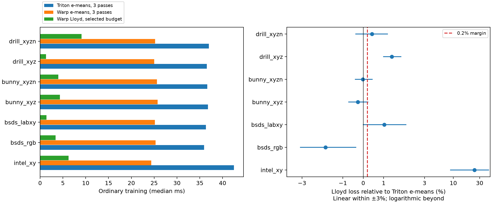

# Pure Warp Lloyd k-means baseline

`warp_emeans.Kmeans` is a full-data Lloyd baseline. Every iteration assigns all points and updates every nonempty center. All clustering kernels, initialization, scans and sorting use Warp; no PyTorch, Triton or Faiss is used by the implementation. Those packages appear only in reference experiments. See the [API contract](../api.md#full-data-lloyd-baseline).

The validation-selected baseline satisfies the predeclared 0.2% loss margin against three-pass upstream Triton e-means on **1 of seven** real feature datasets in this confirmation: bsds_rgb. Reported intervals quantify initialization variation on these fixed inputs. They do not establish superiority across graphics or robotics applications.

## Implementation and tuning

The direct path keeps one point in registers per thread, scans centers without an n-by-k distance matrix, and fuses assignment with partial sum/count atomics. CUDA uses up to 64 accumulation shards to reduce contention, followed by a mean reduction. Empty centers are retained; FP32 distance ties choose the smallest center index. Random initialization samples input row indices without replacement, not k-means++. No early stopping is hidden in the iteration budget.

The large-input path maintains a lower bound on competing-center distance. It subtracts the maximum center movement, tests the current winner, scans flags on device, and groups points requiring another exhaustive search. No active-count readback is needed. The automatic heuristic selects it on CUDA for n>=500,000, 3<=d<=10, k>=256, at least ten iterations, and either d>=5 or k>=512. Other workloads use direct search. This policy was tuned on the present Blackwell GPU; hardware and data distribution can change the best choice.

Bounds use FP64 state and outward relaxation; searched squared distances use direct FP32 subtraction/multiplication/accumulation. Relative guard 16*d*2^-23 and absolute distance guard d*2^-60 cover FP32 rounding and underflow in the supported low-dimensional path. The winner is skipped only with a strict guarded separation, so near ties trigger a search. Maximum movement is inflated by (1+1e-12) plus 1e-30; relaxed bounds shrink by the reciprocal-side margin. Coordinate validation rejects magnitudes above 2^60/sqrt(d), preventing squared-distance and reduction overflow within the indexing limits. Atomic mean updates still vary in the last bits, so this is not a claim of bitwise equivalence to an FP64 Lloyd trajectory.

Distance-bound pruning follows the idea of [Hamerly's accelerated Lloyd method](https://cs.baylor.edu/~hamerly/papers/sdm_2010.pdf), with conservative guards and GPU compaction added here. Bounds without compaction did not improve the tested large workloads because partially active warps still perform searches. Cooperative searches, direct Warp tiles, TF32 tile products with direct-distance refinement, and forced wide-dimension unrolling were also tested. They did not justify replacing the direct path across the tested configurations. Experimental variants remain in `scripts/kmeans_variants.py`, outside the public runtime.

The committed `kmeans_tuning_*.json` files retain exploratory probes, including losing variants and raw samples. Early probes include intermediate source hashes and are not the final performance evidence. The final matrix below measures the public API from the frozen source commit recorded in its metadata. No claim is made that this is the fastest possible k-means implementation on every GPU.

## Fixed-budget matrix

Same 15 synthetic configurations as the existing e-means runtime matrix, plus all seven real feature datasets. Synthetic inputs use the existing normal-distribution generator; real inputs use the [documented corpus](../datasets.md). All methods receive identical initial centers for each of seeds 0,1,2. Lloyd uses 25 full iterations; both e-means implementations use three passes. These are different algorithms and budgets: runtime alone does not establish matched quality.

Timings are medians across three seed medians, each with three warm measurements. Ordinary calls include input validation and allocation. Transfers, JIT warmup, model/graph cleanup and FP64 loss evaluation are outside the timers. Graph replay includes reset and all iterations; its preparation is reported separately. Method order alternates across seeds. All inputs and training arithmetic are FP32 on an NVIDIA RTX PRO 6000 Blackwell MIG 2g.48gb, Warp 1.19.0. This session ran GPU experiments sequentially; the machine can be shared by other users.

Loss columns show percent change in held-out FP64 MSE; negative is lower loss. Three seeds are descriptive, not an equivalence test.

| Dataset | n | d | k | Lloyd 25 ms | Warp e-means ms | Triton e-means ms | Lloyd loss vs Warp | Lloyd loss vs Triton |
| --- | --- | --- | --- | --- | --- | --- | --- | --- |
| normal | 10,000 | 2 | 32 | 1.32 | 15.10 | 25.93 | -1.08% | -0.91% |
| normal | 10,000 | 5 | 32 | 1.33 | 20.27 | 28.19 | -0.26% | -0.01% |
| normal | 10,000 | 10 | 32 | 1.33 | 20.35 | 29.33 | -0.02% | +0.00% |
| normal | 100,000 | 2 | 256 | 1.33 | 18.73 | 35.56 | +4.70% | +3.98% |
| normal | 100,000 | 3 | 256 | 1.53 | 25.47 | 36.11 | -0.38% | -0.10% |
| normal | 100,000 | 4 | 256 | 1.76 | 25.21 | 36.71 | +0.88% | +0.22% |
| normal | 100,000 | 5 | 256 | 2.10 | 25.18 | 37.03 | +0.40% | +0.51% |
| normal | 100,000 | 6 | 256 | 2.32 | 25.23 | 37.18 | -0.45% | +0.10% |
| normal | 100,000 | 8 | 256 | 2.77 | 25.04 | 36.95 | +0.10% | -0.00% |
| normal | 100,000 | 10 | 256 | 3.48 | 24.91 | 36.47 | +0.08% | +0.07% |
| normal | 100,000 | 32 | 256 | 9.64 | 4.08 | 7.61 | -0.09% | -0.12% |
| normal | 100,000 | 100 | 256 | 37.07 | 12.87 | 8.91 | +0.06% | +0.08% |
| normal | 1,000,000 | 2 | 1024 | 16.53 | 23.55 | 54.80 | +7.93% | +8.99% |
| normal | 1,000,000 | 5 | 1024 | 26.50 | 30.96 | 55.38 | +0.57% | +0.61% |
| normal | 1,000,000 | 10 | 1024 | 50.11 | 30.86 | 55.19 | -0.15% | -0.16% |
| intel_xy | 65,536 | 2 | 64 | 1.39 | 24.27 | 42.50 | +55.66% | +15.94% |
| bsds_rgb | 100,000 | 3 | 64 | 1.41 | 25.08 | 36.40 | +8.20% | +4.95% |
| bsds_labxy | 100,000 | 5 | 64 | 1.45 | 25.09 | 36.62 | +2.61% | -0.46% |
| bunny_xyz | 100,000 | 3 | 256 | 1.59 | 25.23 | 36.47 | +0.97% | -0.09% |
| bunny_xyzn | 100,000 | 6 | 256 | 2.31 | 24.99 | 37.12 | +1.03% | +0.77% |
| drill_xyz | 100,000 | 3 | 128 | 1.40 | 25.02 | 36.81 | +0.51% | +0.40% |
| drill_xyzn | 100,000 | 6 | 128 | 1.71 | 25.27 | 37.64 | +2.84% | +3.62% |

### Prepared graph replay

Each entry is replay ms / preparation ms (including warmup and capture). Setup is paid once per prepared workload.

| Dataset | n | d | k | Lloyd 25 replay / setup ms | Warp e-means replay / setup ms |
| --- | --- | --- | --- | --- | --- |
| normal | 10,000 | 2 | 32 | 0.18 / 2.06 | 2.07 / 29.33 |
| normal | 10,000 | 5 | 32 | 0.26 / 2.06 | 4.60 / 39.36 |
| normal | 10,000 | 10 | 32 | 0.39 / 2.03 | 5.47 / 38.94 |
| normal | 100,000 | 2 | 256 | 0.69 / 2.08 | 2.94 / 36.62 |
| normal | 100,000 | 3 | 256 | 0.93 / 2.22 | 6.07 / 49.63 |
| normal | 100,000 | 4 | 256 | 1.18 / 2.57 | 6.35 / 50.13 |
| normal | 100,000 | 5 | 256 | 1.47 / 2.84 | 7.04 / 50.11 |
| normal | 100,000 | 6 | 256 | 1.71 / 3.05 | 7.28 / 49.34 |
| normal | 100,000 | 8 | 256 | 2.15 / 3.51 | 8.02 / 48.71 |
| normal | 100,000 | 10 | 256 | 2.82 / 4.14 | 9.55 / 48.51 |
| normal | 100,000 | 32 | 256 | 9.05 / 10.44 | 3.16 / 7.37 |
| normal | 100,000 | 100 | 256 | 36.53 / 37.77 | 12.26 / 16.24 |
| normal | 1,000,000 | 2 | 1024 | 15.91 / 17.25 | 8.24 / 45.59 |
| normal | 1,000,000 | 5 | 1024 | 25.65 / 32.47 | 17.79 / 63.62 |
| normal | 1,000,000 | 10 | 1024 | 49.37 / 52.23 | 28.99 / 60.54 |
| intel_xy | 65,536 | 2 | 64 | 0.29 / 2.13 | 3.36 / 47.60 |
| bsds_rgb | 100,000 | 3 | 64 | 0.48 / 2.12 | 5.63 / 49.27 |
| bsds_labxy | 100,000 | 5 | 64 | 0.70 / 2.12 | 5.92 / 49.39 |
| bunny_xyz | 100,000 | 3 | 256 | 0.93 / 2.31 | 6.06 / 48.92 |
| bunny_xyzn | 100,000 | 6 | 256 | 1.72 / 3.04 | 7.28 / 49.02 |
| drill_xyz | 100,000 | 3 | 128 | 0.59 / 2.15 | 5.78 / 49.41 |
| drill_xyzn | 100,000 | 6 | 128 | 1.07 / 2.49 | 6.53 / 49.39 |

## Validation-selected quality confirmation

The first Lloyd budget among 1,3,5,10,25,50,100,200 whose mean validation MSE was at most 1.002 times upstream Triton's three-pass MSE was frozen using seeds 0,1,2 and 16,384 validation vectors. Confirmation uses ten new paired initialization seeds 200–209 and 16,384 test vectors. The test split was also used in earlier studies; only initialization seeds are new here. It never selects the Lloyd budget. Cases missing the validation target are still reported at 200 iterations and cannot pass confirmation.

Each timing is the median across seeds of three warmed ordinary train measurements. A paired bootstrap resamples the ten seeds 10,000 times; a match requires the 95% interval upper endpoint for Lloyd/Triton mean loss to be <=1.002. Intervals below are expressed as percent loss difference, so the threshold is +0.2%. The Warp e-means comparator remains at three passes and has separate paired statistics in the summary JSON.

| Dataset | Lloyd iterations | Lloyd ms | Warp e-means ms | Triton e-means ms | Lloyd loss vs Triton [95% interval] | Within margin? |
| --- | --- | --- | --- | --- | --- | --- |
| intel_xy | 200 (no match) | 6.25 | 24.35 | 42.48 | +24.12% [+8.77, +44.47] | No validation match |
| bsds_rgb | 100 | 3.46 | 25.28 | 36.16 | -1.85% [-3.26, -0.34] | Yes |
| bsds_labxy | 25 | 1.38 | 25.18 | 36.33 | +1.03% [-0.02, +2.11] | Inconclusive |
| bunny_xyz | 100 | 4.32 | 25.78 | 36.81 | -0.27% [-0.73, +0.25] | Inconclusive |
| bunny_xyzn | 50 | 4.02 | 25.34 | 42.18 | -0.02% [-0.41, +0.46] | Inconclusive |
| drill_xyz | 25 | 1.37 | 25.67 | 54.42 | +1.40% [+0.98, +1.87] | No |
| drill_xyzn | 200 (no match) | 9.04 | 25.47 | 54.28 | +0.43% [-0.39, +1.21] | No validation match |

### Timing replication

The first confirmation showed intermittent Triton timing outliers in the later cases. A fresh-process replication repeated RGB, Bunny XYZ+normals and both drill cases with five warm measurements per seed, unchanged budgets, and the same ten seeds. The elevated Triton medians did not reproduce; their cause was not isolated. Both archives are retained. Use the replicated times below for those cases; the original quality analysis above remains frozen. RGB's flagship timing is stable across both runs. Entries below are original / replicated ordinary milliseconds.

| Dataset | Lloyd ms | Warp e-means ms | Triton e-means ms |
| --- | --- | --- | --- |
| bsds_rgb | 3.46 / 3.41 | 25.28 / 25.34 | 36.16 / 35.95 |
| bunny_xyzn | 4.02 / 4.01 | 25.34 / 25.60 | 42.18 / 36.66 |
| drill_xyz | 1.37 / 1.32 | 25.67 / 25.03 | 54.42 / 36.53 |
| drill_xyzn | 9.04 / 9.08 | 25.47 / 25.24 | 54.28 / 36.98 |


The figure uses replicated timings where available and the original paired quality intervals.

## Scaling-study integration

The evaluation harness now includes `warp_lloyd25` and `warp_lloyd100`; historical `lloyd25` remains the Faiss CPU baseline. A fresh run evaluates both Warp budgets and upstream-auto Warp e-means on all 33 held-out configurations, using the original seed/split protocol (20–22, 8,192 test rows at offset 16,384). This is a baseline addition on known test data, not a new independent validation of the scaling laws. E-means uses the configured two passes. Timings from this evaluation are not performance evidence.

| Partition | Method | Runs | Median loss vs auto | 90th percentile |
| --- | --- | --- | --- | --- |
| dimension_holdout | warp_lloyd25 | 54 | +0.07% | +1.47% |
| dimension_holdout | warp_lloyd100 | 54 | -0.06% | +1.04% |
| family_holdout | warp_lloyd25 | 24 | +0.56% | +1.64% |
| family_holdout | warp_lloyd100 | 24 | -2.04% | +0.02% |
| real_holdout | warp_lloyd25 | 21 | +1.34% | +4.13% |
| real_holdout | warp_lloyd100 | 21 | -0.40% | +1.92% |

## Evidence and reproduction

Raw [matrix](../../results/kmeans_matrix.json), [validation selection](../../results/kmeans_selection.json), [confirmation](../../results/kmeans_test.json), [timing replication](../../results/kmeans_timing_replication.json), [scaling evaluation](../../results/kmeans_scaling.jsonl), and [summary](../../results/kmeans_summary.json) retain per-seed measurements. Timing files record source hashes and the source commit; the confirmation hashes its frozen selection file. [Validation evidence](../../results/kmeans_validation.json) records tests and sanitizer results. [Issue #14](https://github.com/alecjacobson/warp-emeans/issues/14) tracks implementation and results.

Use fresh output paths; benchmark scripts reject overwriting evidence. Reporting reads the published filenames. Run GPU measurements sequentially:

```sh
uv sync --extra research --extra dev
uv run python scripts/benchmark_kmeans.py --phase matrix --output results/rerun_matrix.json
uv run python scripts/benchmark_kmeans.py --phase select --output results/rerun_selection.json
uv run python scripts/benchmark_kmeans.py --phase test --selection results/rerun_selection.json --output results/rerun_test.json
uv run python scripts/benchmark_kmeans.py --phase test --selection results/rerun_selection.json --datasets bsds_rgb bunny_xyzn drill_xyz drill_xyzn --repeats 5 --output results/rerun_timing_replication.json
uv run python scripts/evaluate_scaling.py --methods upstream_auto warp_lloyd25 warp_lloyd100 --output results/rerun_scaling.jsonl
uv run python scripts/report_kmeans.py  # regenerate the archived report
```

Remaining limitations: one GPU; a small corpus with shared source scenes; FP32 atomic nondeterminism; retained empty centers can limit quality; no k-means++ initialization, spherical metric or distributed/autodiff support. Fixed-budget performance differs from performance at matched loss. The high-dimensional cases and datasets that miss the validation/test margin must remain visible.
