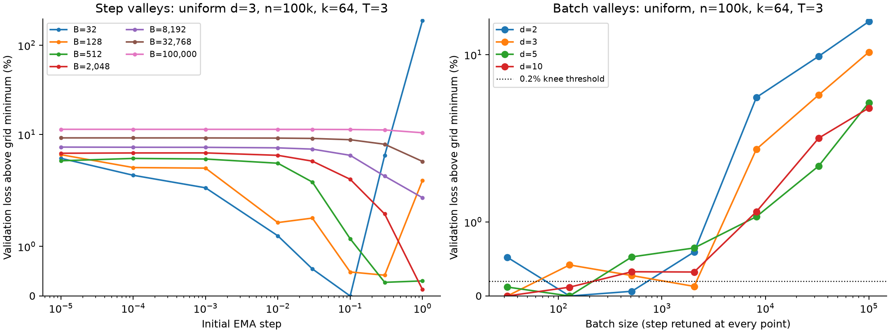
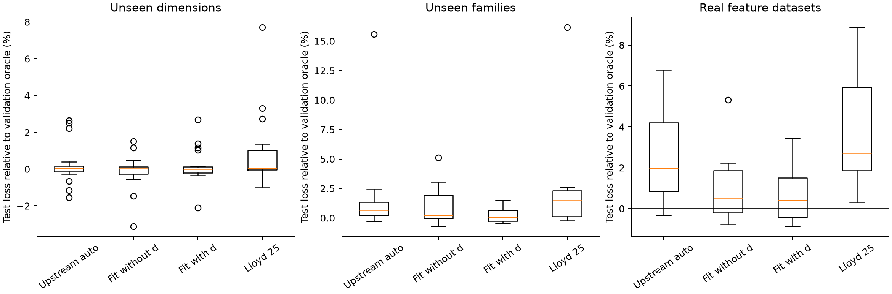

# Low-dimensional scaling study

This study produces candidate empirical laws, not a universal low-dimensional scaling law. The implementation retains upstream defaults. Candidates are fitted on synthetic distributions and tested on unseen dimensions, distribution families and real feature datasets. All results below are measured; boundary censoring, three-seed uncertainty, and corpus coverage limit the conclusions.

## Coverage and protocol

The larger sweep contains 15,912 training runs across 97 configurations. The preceding pilot contains 14,040 runs across 104 configurations. Both use three initialization seeds per cell. The larger fit set uses n=100,000/1,000,000, k=64/256, T=1/3, d=2,3,5,10, with uniform and anisotropic mixture distributions. Held-out dimensions are 4,6,7,8,9,16,32,64,100. Gaussian and noisy two-angle manifold controls test distribution transfer. Seven real feature datasets cover d=2,3,5,6; see the [dataset manifest and application sources](../datasets.md).

The batch ladder is 32,128,512,2048,8192,32768,n; the step ladder is 1e-5,1e-4,1e-3,.01,.03,.1,.3,1. Configurations exceeding 32,768 updates are explicitly omitted, so some large-n small-batch optima remain censored. Training uses FP32 Warp; validation uses 4,096 independent vectors and FP64 direct squared distances. The final test comparison uses fresh seeds 20,21,22 and 8,192 test vectors beginning at offset 16,384, disjoint from the pilot evaluation sample. No test loss selected the candidate coefficients.

The reference fitting target follows [Appendix B](https://arxiv.org/html/2611.09501v1#A2): conditional step minima and a batch knee at +0.2% validation loss. The finite grid cannot establish that precise regret universally. An additional interval fit retains one-sided boundary information and treats flat step valleys as unidentified; it uses a declared weak ridge toward the upstream quality law. Both candidates below are reported without choosing a winner on test loss.

## Candidate coefficients

The forms are `alpha0 = clip(Ca k^ak B^aB n^an T^aT d^ad, 1e-5, 1)` and `B = round_power_of_two(Cb k^bk n^bn T^bT d^bd)`, capped to [1,n]. Omitting d fixes its exponent at zero. These are experimental settings, not replacement defaults.

| Candidate | Ca | ak | aB | an | aT | ad |
|---|---:|---:|---:|---:|---:|---:|
| interval_no_dimension | 0.16439 | -0.5562 | 1.0257 | -0.3123 | 0.8926 | 0.0000 |
| interval_dimension | 0.45572 | -0.5819 | 1.0189 | -0.3112 | 0.9533 | -0.6736 |

| Candidate | Cb | bk | bn | bT | bd |
|---|---:|---:|---:|---:|---:|
| interval_no_dimension | 0.26657 | 0.4768 | 0.4077 | 0.1441 | 0.0000 |
| interval_dimension | 0.14083 | 0.4894 | 0.4001 | 0.1283 | 0.4800 |

Coefficient bootstrap intervals and residuals are in [scaling_intervals.json](../../results/scaling_intervals.json). The 100 bootstrap draws resample problem configurations and seeds within this finite design; they do not estimate population uncertainty across arbitrary applications. The two source distributions and shared nested samples limit effective independence.

The ordinary point-minimum fit is retained in [scaling_canonical_fit.json](../../results/scaling_canonical_fit.json). Its censoring diagnostics are: `{"alpha_boundary": 226, "batch_minimum_lower_boundary": 17}`. Do not interpret a flat curve’s arbitrarily selected minimum as an identified optimum.

## Independent test comparison

Entries are median / 90th-percentile percent loss relative to the validation-selected grid setting, rerun on the same fresh seeds. Negative values mean a method beat that validation-selected setting on test; the comparator is not a test-selected optimum. Historical `lloyd25` uses Faiss CPU with 25 iterations and all training rows; e-means transfer runs use two passes. These are loss comparisons, not cross-device timing comparisons. The added `warp_lloyd25` and `warp_lloyd100` GPU baselines have a [separate benchmark and evaluation](kmeans-baseline.md); this archived table is unchanged.

| Method | Unseen dimensions | Unseen families | Real feature datasets |
|---|---:|---:|---:|
| upstream_auto | +0.054% / +2.303% | +0.664% / +6.355% | +1.971% / +5.868% |
| upstream_quality | +0.049% / +2.303% | +0.664% / +6.355% | +1.971% / +5.868% |
| upstream_throughput | +0.080% / +2.577% | +1.320% / +6.754% | +2.545% / +17.029% |
| interval_no_dimension | +0.033% / +0.682% | +0.214% / +3.634% | +0.481% / +3.468% |
| interval_dimension | +0.008% / +1.230% | +0.067% / +1.176% | +0.416% / +2.568% |
| lloyd25 | +0.046% / +2.904% | +1.482% / +6.674% | +2.717% / +7.859% |

| Real dataset | Upstream auto | No-dimension candidate | Dimension candidate |
|---|---:|---:|---:|
| intel_xy | +6.785% | +5.315% | +3.435% |
| bsds_rgb | +3.150% | +2.236% | +0.416% |
| bsds_labxy | -0.327% | -0.220% | -0.878% |
| bunny_xyz | +0.489% | -0.754% | -0.242% |
| drill_xyz | +1.210% | -0.190% | -0.599% |
| bunny_xyzn | +1.971% | +0.481% | +1.019% |
| drill_xyzn | +5.257% | +1.481% | +1.989% |

The real-data table has seven feature datasets, not seven independent application domains: RGB and LabXY share images; XYZ and XYZ+normal variants share two meshes; Intel is one robot trajectory with revisited places. Surface samples are independent points on fixed reconstructions, not independent acquired scans. SLIC and VCCS features are Euclidean surrogates without their original locality/connectivity constraints.

## Revival ablation

Both arms retune B and alpha on the same validation ladder. Entries show best median validation MSE with revival on relative to off; three seeds do not establish significance. This checks a confound: the default recipe changes revival at d=2, so the dimension exponent is conditional on that policy.

| d | Uniform on/off difference | Mixture on/off difference |
|---|---:|---:|
| 2 | +0.463% | +7.291% |
| 3 | +0.135% | -1.333% |
| 5 | +0.007% | -1.250% |
| 10 | +0.077% | -1.349% |

## Figures





## Reproduction and remaining work

To regenerate the published report and figures from the committed measurements, run `uv run python scripts/report_scaling.py` followed by `uv run python scripts/report_real_confirmation.py`.

For a new measurement run, use a fresh destination so the original evidence remains intact:

```sh
uv sync --extra research --extra dev
uv run python scripts/build_corpus.py
mkdir -p results/rerun
uv run python scripts/sweep_scaling.py --profile canonical --output results/rerun/canonical.jsonl
uv run python scripts/fit_scaling.py --input results/rerun/canonical.jsonl --output results/rerun/point_fit.json
uv run python scripts/fit_intervals.py --input results/rerun/canonical.jsonl --output results/rerun/intervals.json
uv run python scripts/evaluate_scaling.py --sweep results/rerun/canonical.jsonl --fits results/rerun/intervals.json --output results/rerun/evaluation.jsonl
uv run python scripts/evaluate_scaling.py --sweep results/rerun/canonical.jsonl --fits results/rerun/intervals.json --output results/rerun/confirmation.jsonl --only-real --seed-start 30 --seed-count 30 --test-offset 24576 --test-rows 4096 --methods upstream_auto validation_oracle interval_no_dimension interval_dimension
uv run python scripts/sweep_scaling.py --profile revival --output results/rerun/revival.jsonl
```

Resume is allowed only when recorded provenance matches; changed code or settings require a fresh output. The larger sweep's generating files were verified against commit `682326e4cf238ae37587c1fd87a4d2b9fe9f6ae7`, recorded in its metadata. That version predates the subnormal revival fix and transposed CUDA center layout. The subnormal corner is outside the ordinary-scale corpus; final performance and correctness tests use the fixes. Archived evaluations have less complete source metadata than the sweep; newer evaluation runs record code and input hashes. The current report scripts intentionally read the published result filenames; compare reruns separately before replacing any evidence.

Raw append-only records: [larger sweep](../../results/scaling_canonical.jsonl), [pilot](../../results/scaling_sweep.jsonl), [fresh-seed test evaluation](../../results/scaling_evaluation.jsonl), [revival](../../results/scaling_revival.jsonl). Companion meta files record recipes, grids, software/source fingerprints and evaluation provenance. Exact repeated FP32 outputs can differ because atomics and split thresholds are sensitive to accumulation order.

Further work should refine the grid near identified valleys, widen censored small-batch regions, add independent scenes and robot logs, fit multiple distribution realizations, and evaluate more seeds before changing defaults. Study intrinsic dimension and covariance/cluster imbalance separately from ambient dimension. Strong equal-loss timing evidence is tracked in the [real-data benchmark](equal-loss.md); wider-dimensional runtime optimization remains [issue #6](https://github.com/alecjacobson/warp-emeans/issues/6).

## Thirty-seed real-data confirmation

Both larger-study laws were frozen before this confirmation. Thirty fresh seeds (30–59) and 4,096 test points beginning at offset 24,576 are disjoint from the earlier reported evaluation. The tables compare mean test MSE with upstream auto using paired seed bootstrap intervals (10,000 resamples). They quantify initialization uncertainty for these fixed seven feature datasets. A law is not accepted merely because its aggregate median looks good.

| Dataset | No-dimension / auto [95% interval] | Dimension / auto [95% interval] |
|---|---:|---:|
| intel_xy | 0.9804 [0.9626, 0.9999] | 0.9557 [0.9359, 0.9746] |
| bsds_rgb | 0.9740 [0.9645, 0.9841] | 0.9802 [0.9660, 0.9946] |
| bsds_labxy | 0.9979 [0.9906, 1.0051] | 0.9972 [0.9913, 1.0029] |
| bunny_xyz | 0.9884 [0.9844, 0.9927] | 0.9895 [0.9860, 0.9932] |
| drill_xyz | 0.9901 [0.9858, 0.9946] | 0.9922 [0.9873, 0.9973] |
| bunny_xyzn | 0.9875 [0.9846, 0.9907] | 0.9938 [0.9896, 0.9980] |
| drill_xyzn | 0.9725 [0.9673, 0.9777] | 0.9846 [0.9794, 0.9899] |

These results do not justify replacing upstream defaults with either candidate across all low-dimensional applications. Dataset geometry and distribution shift remain material. The next fit should include representative surface/image/robotics families with additional independent source scenes and distribution descriptors, while preserving genuinely new evaluation data. [Raw confirmation](../../results/scaling_real_confirmation.jsonl) and [summary](../../results/scaling_real_confirmation_summary.json).
